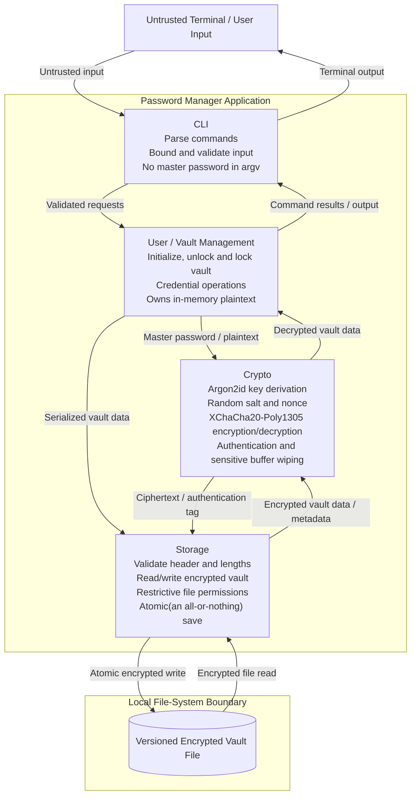

# Checkpoint 1 — Threat Model and Architecture

**Project:** Offline Password Manager  
**Language:** C17  
**Target platforms:** Linux, macOS, Windows

## 1. Scope and security objectives

The project is a single-user, offline command-line password manager that stores one encrypted vault on a local device. Planned operations are `init`, `add`, `list`, `get`, `update`, `delete`, `lock`, `unlock` and `change-master`. Credentials are stored as a label, account name, password, and optional URL/notes.

The security objectives are confidentiality and integrity of vault contents at rest:

- resistance to offline guessing subject to the entropy of the master password and the configured password-KDF cost
- minimizing plaintext exposure in memory and the interface
- rejecting modified, truncated, or incorrectly authenticated vaults.

## 2. Components and trust boundaries

The master password is read through a no-echo terminal prompt into a bounded buffer, passed to the crypto module for key derivation, and promptly wiped.

On **unlock**:

1. storage loads an untrusted file and validates its bounds
2. crypto derives a key from the entered master password and authenticates/decrypts the payload
3. the vault module parses records.

On **save**:

1. the vault module serializes records with explicit size limits
2. crypto encrypts/authenticates them using a newly generated nonce
3. storage atomically replaces the vault on disk.

The CLI displays only the fields requested, and should not log secrets.

The architecture diagram shows logical calls rather than directly coupling all modules: vault management orchestrates storage and crypto; storage must never receive a key or plaintext credential; crypto must not perform file I/O. The file system, vault bytes, terminal input, and command arguments are untrusted boundaries. The process memory and cryptographic library are trusted **only while the host OS and process remain uncompromised**.

## 3. Threat model

**Adversaries:** (A) someone who obtains a copy of the encrypted vault; (B) another local account who can view files/process arguments/terminal output subject to OS permissions; (C) a person who can modify or replace the vault; (D) malware or an administrator on the running device (explicitly outside the confidentiality guarantee). Assets include the master password, derived key, decrypted credentials, vault file, and user-visible output.

| Asset / entry point | Threat | Intended mitigation |
|---|---|---|
| Master password / entry | Shoulder surfing, terminal echo, password exposed in command arguments or shell history | Read using a platform-specific no-echo interactive prompt; do not accept the password as an argv value; no debug logging of secrets. |
| Master password / stolen vault | Offline dictionary or brute-force attack against a low-entropy password | Use libsodium `crypto_pwhash` with Argon2id, per-vault CSPRNG salt, recorded KDF parameters, and an explicit minimum passphrase policy; calibrate memory/CPU settings for supported devices. |
| Master password / memory | Password remains in buffers after use or in unintended copies | Minimize copies and lifetime; use `sodium_memzero` on mutable password buffers; test error paths. |
| Vault at rest / file theft | Disclosure of stored account names, passwords, URLs or notes | Encrypt **all** credential records, not just password fields, with XChaCha20-Poly1305; store only salt, KDF parameters, version, nonce, length and ciphertext/tag in cleartext. |
| Vault at rest / modification | Bit-flips, replacement, forged records, altered encryption metadata | AEAD authentication with an authenticated header as associated data; validate magic, version, KDF limits, file size and payload length before allocation or KDF work; reject authentication failures without releasing plaintext. |
| Vault at rest / rollback or deletion | Attacker restores an older valid vault or deletes it | Atomic save, backup/recovery instructions and restrictive file/directory permissions. |
| Vault at rest / partial write | Power loss leaves a corrupted or half-written vault | Write a same-directory temporary file with restrictive permissions, flush data, then atomically replace the destination where supported; document platform-specific durability limits; never overwrite the original before a successful encrypted write. |
| Vault in memory / unlocked session | Plaintext credentials or derived key exposed by a memory scraper, swap, crash dump or overly long unlocked session | Keep plaintext and key lifetime short; use `sodium_malloc`/`sodium_free` and `sodium_mlock` where feasible, wipe secrets, and implement explicit lock/exit. |
| Vault in memory / parser | Crafted vault causes integer overflow, out-of-bounds read/write, unbounded allocation, or malformed-record processing | Enforce total-size, record-count, field-length and checked-arithmetic limits; parse only **after** authentication. |
| Interface / input | Oversized or malformed labels, terminal-control injection, command injection, format-string bugs | Bounded input and explicit length checks; escape control characters in displayed fields; use fixed format strings; avoid invoking a shell with user data. |
| Interface / output | Secret leaks via stdout, scrollback, redirected output or clipboard | Never print master password; `get` displays a password only upon explicit request with a warning that terminal output/scrollback can persist. |
| Interface / error handling | Distinguishable password vs. tampered-file messages reveal internal state; diagnostic logs leak values | Generic unlock/authentication failure message, no secret-bearing logs, and consistent cleanup across errors. |
| Dependencies / distribution | Modified or outdated crypto library; unsafe build flags | Pin/document a supported libsodium version and download from trusted distribution channels; enable compiler warnings, CI tests and platform-specific hardening. |

## 4. Vault format (initial specification)

Use a **single versioned binary file** (`vault.pmv` by default). All integers are unsigned little-endian and parsing must use explicit byte decoding rather than casting file bytes to a C struct. The header is fixed-size for format version 1:

| Field | Size | Meaning |
| --- | --- | --- |
| Magic | 8 bytes | ASCII `PMVAULT1` |
| Format version | 1 byte | `1` |
| KDF algorithm ID | 1 byte | `1` = Argon2id |
| AEAD algorithm ID | 1 byte | `1` = XChaCha20-Poly1305 |
| Reserved | 1 byte | Zero; reject otherwise |
| Argon2id opslimit | 8 bytes | Explicit stored work factor; bounded before use |
| Argon2id memlimit | 8 bytes | Explicit stored bytes; bounded before use |
| Salt | 16 bytes | Random `crypto_pwhash_SALTBYTES` |
| Nonce | 24 bytes | Random `crypto_aead_xchacha20poly1305_ietf_NPUBBYTES` |
| Ciphertext length | 8 bytes | Includes the 16-byte AEAD authentication tag |
| Ciphertext and tag | Variable | Encrypted serialized credential records |

The full fixed header (76 bytes) is supplied as **AEAD associated data**, binding the version, algorithms, KDF parameters, salt, nonce and declared ciphertext length to the ciphertext. KDF parameters are necessarily read before authentication, so they must be checked against conservative limits **before** they are used. The entire file length must equal the header length plus ciphertext length.

After successful AEAD verification, plaintext is decoded as a versioned, length-prefixed record sequence (no NUL-terminated strings on disk); define and test its exact byte schema prior to implementing `add` or `get`. The vault stores no master-password hash or recoverable master password. An incorrect master password and a corrupted vault both produce an authentication failure. Save must generate a fresh random nonce for every encryption under a given key; changing the master password requires new salt, new derived key, and re-encryption. Fresh salt/nonce are generated using libsodium's CSPRNG.

## 5. Cryptographic scheme and dependency justification

- Initialize libsodium with `sodium_init()` and fail closed if initialization fails.
- Use `crypto_pwhash(..., crypto_pwhash_ALG_ARGON2ID13)` to derive a 32-byte key from the master password and the stored random salt. Save the numeric opslimit/memlimit; select and benchmark the initial cost on target devices before implementation. Reject unreasonably large or unsupported parameters in an untrusted file.
- Use `crypto_aead_xchacha20poly1305_ietf_encrypt` and the matching decrypt function, with a fresh 24-byte nonce on **every** save and the full header as associated data. Never consume unauthenticated plaintext.
- Source randomness from libsodium `randombytes_buf`, not `rand()`; wipe sensitive mutable buffers with `sodium_memzero`.

**Why libsodium:** it supplies reviewed, portable, documented high-level C APIs for authenticated encryption, Argon2id, cryptographic randomness, and memory-handling utilities. It avoids creating custom cryptographic primitives or combining unauthenticated encryption with an ad hoc MAC.
**Why CMake:** it offers one cross-platform build definition and can discover/link a separately installed libsodium package. No web, GUI, database, or network framework is necessary for this offline CLI design.
