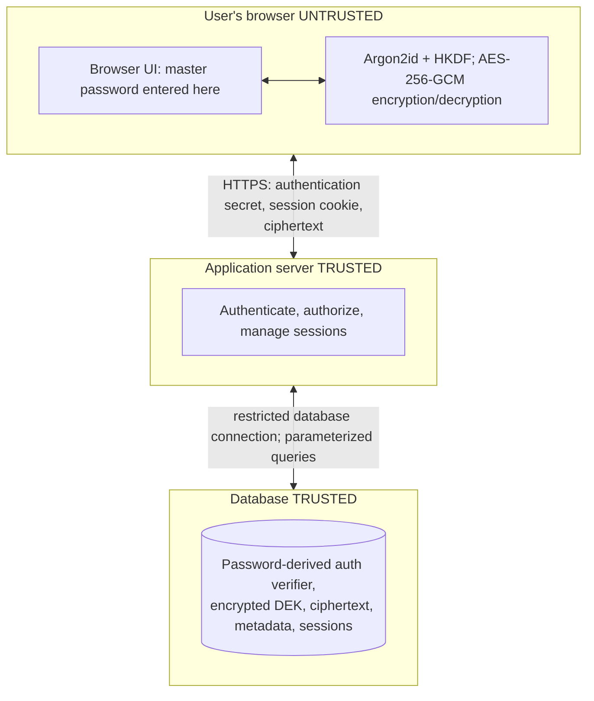

# Secure Password Manager — Design document

This document describes the target design. The HTTPS server and SQLite schema are implemented; authentication and browser cryptography remain planned. See README.MD for current progress and run instructions.

## 1. Scope and assets

A web application for a user to register, log in, create/view/edit/delete their own encrypted credential records, and generate passwords. The user enters **one master password** for account authentication and vault unlocking.

Protected assets: plaintext vault records, master password, vault encryption key, account authentication secret, and authenticated session. Threat actors: unauthenticated internet user, malicious authenticated user, database thief, attacker controlling an external web page, and attacker who compromises the application's delivered JavaScript.

## 2. System architecture diagram

**Encryption boundary:** Credentials are encrypted/decrypted in the browser, *before* upload and *after* download. The server stores and returns ciphertext only. TLS encrypts browser–server traffic.

**Limitations:** A compromised application server can deliver malicious JavaScript and capture secrets when a user unlocks their vault. A compromised device, browser extension, or XSS can also read unlocked contents. The database still reveals account IDs, item counts, sizes, and timestamps.

## 3. Tech stack

| Chosen tech | Justification |
| --- | --- |
| Vanilla HTML, CSS, JS | Vanilla approach allows the frontend to be lightweight and avoide unnecessary dependencies. |
| Node.js with Express | Handles HTTP, seesions, api routing, serves static files |
| SQLite | Lightweight databse that doesn't require it's own serevr, convinient for the scale |
| Web Crypto API and argon2-browser | Client-side, in-browser crytpography. Web crypto API is native to most modern browsers, argon2-browser is the implementation of Argon2id for browsers. |
| argon2 Node.js package | Allows the backend to hash and verify the password-derived authentication secret using Argon2id. |

## 4. Planned cryptographic design

1. **Registration:** The browser generates a unique random salt (at least 16 bytes), uses Argon2id(master password, salt, recorded parameters) to produce a 32-byte root key, and derives two distinct 32-byte values using HKDF-SHA-256 with separate context labels: `auth/v1` and `vault-wrap/v1`. The first is a password-equivalent **authentication secret**; the second is the key-encryption key (KEK). Neither the master password, root key, nor KEK is sent to the server.
2. **Vault key:** The browser generates a random 32-byte data-encryption key (DEK) and encrypts/wraps it with the KEK using AES-256-GCM and a fresh 12-byte nonce. The backend stores only the encrypted DEK, nonce, KDF salt and parameters, and crypto format version.
3. **Authentication:** The browser sends the authentication secret through HTTPS. The server stores an independently salted **Argon2id hash** of that secret for subsequent verification.
4. **Vault records:** The browser encrypts each entire entry (title, URL, username, password, notes) using the DEK and AES-256-GCM with a fresh unique 12-byte nonce. Bind user ID, entry ID and crypto version using authenticated additional data (AAD); keep the same AAD on decryption. The API never receives plaintext entries.
5. **Unlock:** The browser fetches KDF parameters and encrypted DEK, derives keys from the supplied master password, authenticates, then unwraps the DEK locally. Hold the DEK and plaintext records only in non-persistent browser memory while unlocked; clear application references at lock/logout.

**Database storage:** `users(id, email, auth_verifier, created_at)`; `vault_keys(user_id, kdf_salt, kdf_parameters, wrapped_dek, wrapping_nonce, crypto_version)`; `vault_items(id, user_id, ciphertext, nonce, crypto_version, created_at, updated_at)`; `sessions(session_id_hash, user_id, created_at, last_activity_at, absolute_expiry)`.

## 5. Authentication and session plan

- **Login:** Request the account's public KDF metadata; derive keys locally; submit the authentication secret over HTTPS; backend verifies its stored salted hash and issues a **new**, unpredictable, opaque server-side session ID. Generic errors, rate limiting, and consistent handling of nonexistent accounts reduce enumeration and brute-force attacks.
- **Cookies (HTTPS deployment):** `__Host-session` with `Secure`, `HttpOnly`, `SameSite=Strict`, `Path=/`, no `Domain`, no persistent client-side token storage.
- **Expiry and fixation:** Enforce an illustrative 15-minute idle and 8-hour absolute session timeout **on the server**, rotate the session ID after login or privilege change and invalidate the previous ID; revoke on logout. Keep the vault locked after 5 minutes of inactivity, independently of the account session.
- **CSRF:** SameSite is defense in depth; additionally verify Origin and use CSRF tokens for state-changing requests. Apply authorization checks on every protected route.
- **Optional MFA (later):** TOTP verification after password-equivalent authentication and before session issuance, with separate protected recovery-code handling. MFA protects login but does not prevent offline guesses against stolen vault ciphertext.

## 6. Threat model

Threats taken from **OWASP Top 10:2025** in descending order.

| ID / OWASP category | Intended mitigation |
| --- | --- |
| T01 / A01 Broken Access Control | Server-side authentication and ownership-scoped queries on **every** route; deny by default. |
| T02 / A02 Security Misconfiguration | Production configuration baseline, same-origin frontend/API, private DB, HTTPS and secure headers. |
| T03 / A03 Software Supply Chain Failures | NO auto-update, minimal third-party scripts, CI/CD pipeline for checks |
| T04 / A04 Cryptographic Failures | Client-side Argon2id/HKDF key separation, random DEK, AES-GCM unique nonce per key. |
| T05 / A05 Injection | Parameterized SQL, input validation, contextual output encoding/safe rendering, restrictive CSP. |
| T06 / A06 Insecure Design | Account authentication and vault decryption remain separate: the server authenticates the user, while the vault is unlocked locally in the browser. |
| T07 / A07 Authentication Failures | Login throttling, generic errors, server-enforced timeouts, session-ID rotation, cookie flags. |
| T08 / A08 Software or Data Integrity Failures | AES-GCM authentication + AAD; revision checks; protect application build/deployment. |
| T09 / A09 Security Logging and Alerting Failures | Log security events and alert on repeated failures; never log secrets, ciphertext keys or session IDs. |
| T10 / A10 Mishandling of Exceptional Conditions | Fail closed, uniform API errors, no stack traces to users. |

## References

- [OWASP Top 10:2025](https://top10.owasp.org/2025/)
- [OWASP Password Storage Cheat Sheet](https://cheatsheetseries.owasp.org/cheatsheets/Password_Storage_Cheat_Sheet.html)
- [OWASP Cryptographic Storage Cheat Sheet](https://cheatsheetseries.owasp.org/cheatsheets/Cryptographic_Storage_Cheat_Sheet.html)
- [OWASP Session Management Cheat Sheet](https://cheatsheetseries.owasp.org/cheatsheets/Session_Management_Cheat_Sheet.html)
- [OWASP Cross-Site Request Forgery Prevention Cheat Sheet](https://cheatsheetseries.owasp.org/cheatsheets/Cross-Site_Request_Forgery_Prevention_Cheat_Sheet.html)
- [Web Crypto API docs](https://developer.mozilla.org/en-US/docs/Web/API/Web_Crypto_API)
- [Mermaid Cheat Sheet](https://jojozhuang.github.io/tutorial/mermaid-cheat-sheet/)
